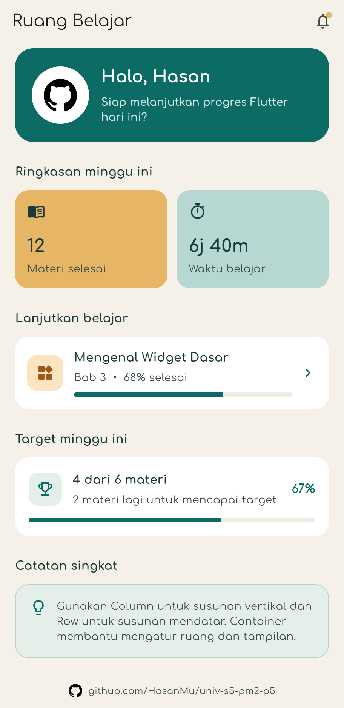

# Ruang Belajar

Aplikasi mobile **Ruang Belajar** adalah dashboard belajar Flutter sederhana yang menampilkan sapaan pengguna, ringkasan progres mingguan, target belajar, materi yang sedang dipelajari, dan catatan singkat.

🔗 **Repository GitHub:** [github.com/HasanMu/univ-s5-pm2-p5](https://github.com/HasanMu/univ-s5-pm2-p5)

## Screenshot

<p align="center">
  
</p>

## Fitur

- Kartu sapaan dengan avatar GitHub dan ajakan melanjutkan belajar.
- Ringkasan minggu ini: jumlah materi selesai dan total waktu belajar.
- Kartu "Lanjutkan belajar" berisi materi terakhir, bab, persentase, dan progress bar.
- Kartu target mingguan dengan capaian materi dan progress bar.
- Catatan singkat berisi tips dasar layout Flutter (`Column`, `Row`, `Container`).
- Tautan repository GitHub di bagian bawah halaman yang dapat diketuk.
- Tema warna hijau toska dengan font Comfortaa dan dukungan Material 3.
- Layout responsif yang aman untuk layar kecil (dapat di-scroll).

## Teknologi

- [Flutter](https://flutter.dev/) 3.47 (stable)
- Dart 3.13
- Material 3
- [`url_launcher`](https://pub.dev/packages/url_launcher) untuk membuka tautan repository
- Font Comfortaa (bundled di `assets/fonts/`)

## Menjalankan Proyek

Pastikan Flutter sudah terpasang, lalu jalankan:

```bash
flutter pub get
flutter run
```

Untuk menjalankan di browser:

```bash
flutter run -d chrome
```

## Menjalankan Pengujian

```bash
flutter analyze
flutter test
```

## Struktur Proyek

```text
lib/
└── main.dart          # Tema aplikasi dan seluruh widget halaman
assets/
├── fonts/             # Font Comfortaa (Regular & Bold)
└── github.png         # Avatar dan ikon tautan GitHub
test/
└── widget_test.dart   # Pengujian widget utama
main.png               # Screenshot aplikasi
```

## Deskripsi Repository

Teks berikut dapat dipakai pada kolom **Description** repository GitHub maupun deskripsi pengumpulan tugas:

> Ruang Belajar — dashboard belajar Flutter dengan ringkasan progres, target mingguan, dan catatan singkat. Dibuat untuk tugas Pemrograman Mobile II.

Jangan lupa menyertakan tautan repository pada deskripsi pengumpulan tugas:
<https://github.com/HasanMu/univ-s5-pm2-p5>

## Publikasi ke GitHub

Jika proyek ini belum terhubung ke repository, jalankan perintah berikut dari root proyek:

```bash
git init
git add .
git commit -m "feat: aplikasi Ruang Belajar"
git branch -M main
git remote add origin https://github.com/HasanMu/univ-s5-pm2-p5.git
git push -u origin main
```

---

Dibuat untuk tugas mata kuliah **Pemrograman Mobile II**.
